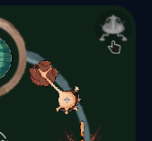
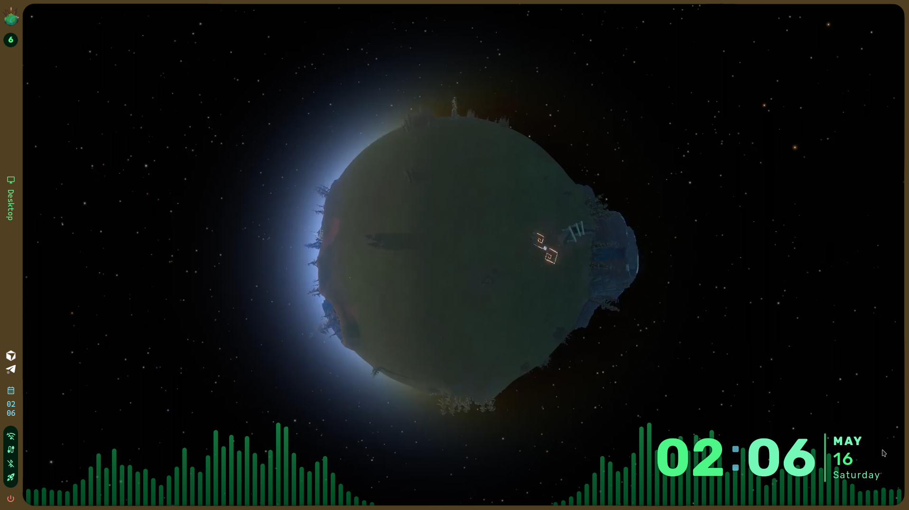
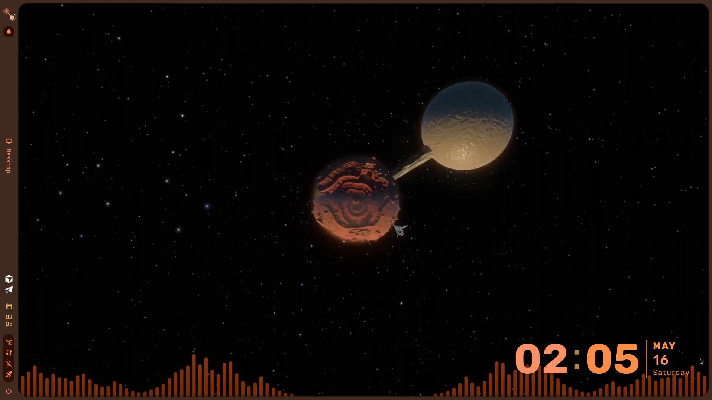
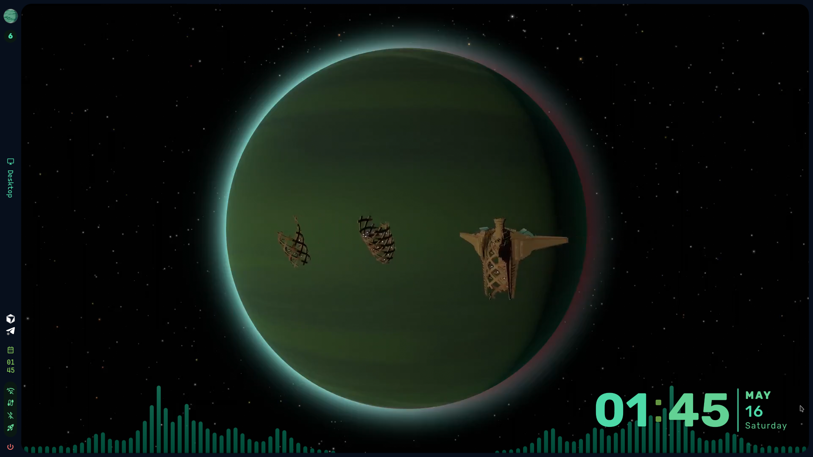
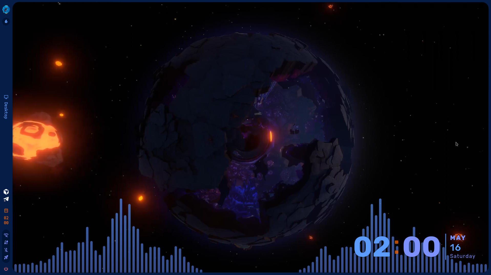
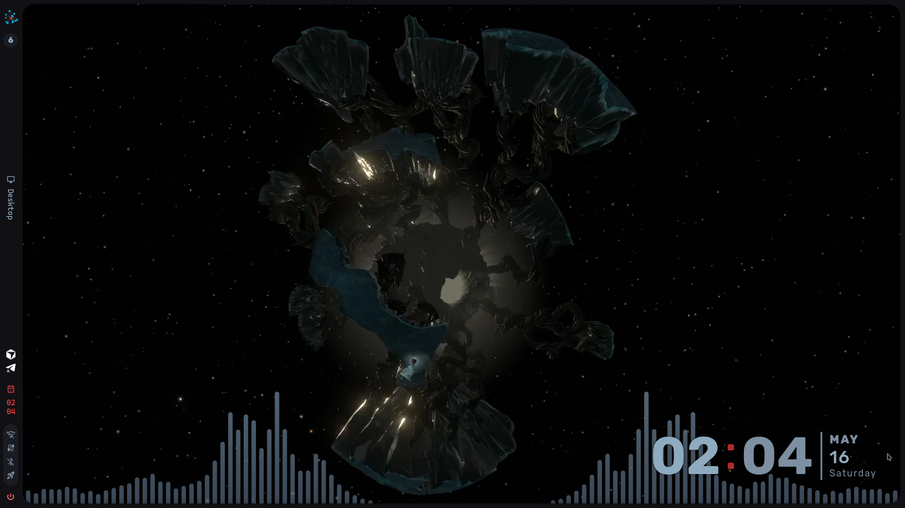

# Quantum Moon

**[Quantum Moon](https://github.com/atlazlp/Quantum-Moon)** is a standalone **Hyprland** desktop by **[atlazlp](https://github.com/atlazlp)**: an *Outer Wilds* homage with its own **Quickshell** shell (`quantum-moon`), a native **Lua** Hyprland config, and a planet engine that re-themes the whole desktop (wallpapers, the centre-monitor video, Hyprland colours, GTK, Qt, kitty) every time the Quantum Moon moves.

The visual language is Nomai: angular hexagons and chamfered frames, thin glowing lines in the planet's colour, ship-log node-and-edge layouts, quick glyph "write-in" reveals. No rounded pills, no jelly.

## Spoiler warning (*Outer Wilds*)

This setup uses *Outer Wilds* art, names and motifs that **reveal major story beats and places**. *Outer Wilds* is a game you only get to discover once. **Play it before installing this theme** if you have not finished it and want to stay unspoiled.

The on-shell **Quantum Moon** control surfaces **five** planetary stops on the selector ring. **Six** full modes in the repo cover every world that moon can visit, each with its own palette, per-monitor wallpapers and an optional centre-monitor video.

## Preview

> Screenshots in `docs/screenshots/` are being retaken for the new shell; the ones below still show the layout of the planet system (wallpapers, panel, scout lock).

### Random planet: the Quantum Moon button

Click the small moon beside the selector ring to jump to a **random** planet. Click a planet to go there directly.

<p align="center">
  
</p>

### Lock your world: the scout indicator

Use your **scout** to take a picture and **lock** the planet you are on. While locked the desktop stays on that world; unlocked, the Quantum Moon can still **change planets when you are not looking** (idle, before lock, before sleep).

<p align="center">
  
</p>

### Five planetary stops

| Timber Hearth | Hourglass Twins | Giant's Deep | Brittle Hollow | Dark Bramble |
|---|---|---|---|---|
|  |  |  |  |  |

## What is in the box

- **Hyprland config in Lua** (`hypr/`): every keybind, rule and animation, plus in-process features that used to be shell scripts: Alt-Tab cycling, scratchpad toggle, Super-tap launcher, thumb-button submaps with a Steam-game guard, Proton ghost-window hiding, monitor hotplug re-layout, game-mode detection (pauses the wallpaper video), Telegram fullscreen fix, per-planet night light.
- **The `quantum-moon` shell** (`shell/`): top hex-segment bar, launcher with app / window / clipboard / emoji / calculator modes, notifications with a persistent **ship-log** history, sidebar, dashboard, OSD, session menu, lock screen, Quantum Moon panel, window picker, utilities (recorder, screenshots, idle inhibit, night light), updates indicator, Docker/Ollama/Open WebUI panel, KVM (lan-mouse) panel, audio device panel, settings window, VPN toggle, Azure DevOps PR watcher.
- **The planet engine** (`quantum-moon/`): modes, palettes, `qm-apply`, `qm-random`, video helpers.
- **User commands** (`bin/`): `qm-apply`, `qm-random`, `qm-lock`, `qm-screenshot`, `qm-record`, `qm-clip`, `qm-emoji`, `qm-update`, `qm-backup`, `qm-restart-shell`, `qm-shell` (IPC), `qm-toast`, `qm-fetch-videos`.
- **System glue** (`config/`): user units for a UWSM session, uwsm env, pacman package-list hook, borg backup timer, GTK/kitty/mime defaults, package lists.

## Install

See **[docs/install.md](docs/install.md)**. Short version, on Arch / CachyOS:

```sh
GIT_LFS_SKIP_SMUDGE=1 git clone https://github.com/atlazlp/Quantum-Moon.git ~/Projects/Quantum-Moon
cd ~/Projects/Quantum-Moon
./scripts/install.sh --dry-run --full      # read the plan
./scripts/install.sh --full                # user-level parts
./scripts/system-steps.sh --run --all      # the sudo parts (packages, SDDM uwsm session, hooks)
qm-fetch-videos                             # optional: the six centre-monitor videos (~110 MB each, Git LFS)
```

Then log out and pick **Hyprland (uwsm)**. After install: **[docs/post-install.md](docs/post-install.md)** (shortcuts, monitors, VPN, PR watcher, backups), **[docs/lua-config.md](docs/lua-config.md)** (how the Hyprland config is organised), **[docs/shell-ipc.md](docs/shell-ipc.md)** (IPC targets and global shortcuts).

## Layout

| Path | Purpose |
|------|---------|
| [`hypr/`](hypr/) | Hyprland Lua config, `features/`, kept bash helpers in `scripts/` |
| [`shell/`](shell/) | Quickshell config `quantum-moon` (config, theme, components, services, modules) |
| [`quantum-moon/`](quantum-moon/) | Planet engine: `modes/<slug>/` (palette, meta, logo, wallpapers, video), `palettes/`, `scripts/` |
| [`bin/`](bin/) | `qm-*` user commands (symlinked into `~/.local/bin`) |
| [`config/`](config/) | Config templates, systemd user units, uwsm env, pacman hook, GTK/kitty/mime defaults, package lists |
| [`scripts/`](scripts/) | `install.sh`, `system-steps.sh`, `migrate-caelestia-state.sh`, `uninstall-caelestia.sh`, `cleanup-leftovers.sh`, `backup-baseline.sh`, `shell-dev.sh`, `hypr-verify.sh` |
| [`extras/`](extras/) | System-level extras (middle-mouse debounce service) |
| [`docs/`](docs/) | Install and reference docs, `dev/` design notes, `screenshots/` |

## Credits

- **Author**: [atlazlp](https://github.com/atlazlp).
- **Planet icons and miniatures**: [artesracor on Behance](https://www.behance.net/artesracor).
- **Videos**: captured from the game with [Cinematic Unity Explorer for Outer Wilds](https://github.com/MegaPiggy/Cinematic-Unity-Explorer-For-Outer-Wilds) and OBS.
- **Scout logo**: 3D render using [outer-scout-blender](https://github.com/Picalines/outer-scout-blender).
- **Selector ring and style advice**: [amayassm](https://amayassm.tumblr.com/).
- **Compositor**: [Hyprland](https://github.com/hyprwm/Hyprland). **Shell toolkit**: [Quickshell](https://quickshell.org).
- Early versions of this desktop were a patch set over [Caelestia](https://github.com/caelestia-dots/caelestia); the shell has since been rewritten and is independent of it.

## Licensing

**Original code and configuration** in this repository is licensed under the [MIT License](LICENSE). That license applies only to materials contributed here as **Quantum Moon** originals; it does **not** cover *Outer Wilds* intellectual property, third-party assets bundled for personal theming, or upstream projects, each of which stays under its own terms.

All intellectual property in *Outer Wilds* (story, characters, names, artwork, audio, branding, trademarks) belongs to **Mobius Digital**, **Annapurna Interactive** and their licensors. **Quantum Moon** is a free, fan-made homage and is **not** affiliated with, endorsed by, or sponsored by those rights holders. Game recordings in this project were captured from a legally purchased copy.
